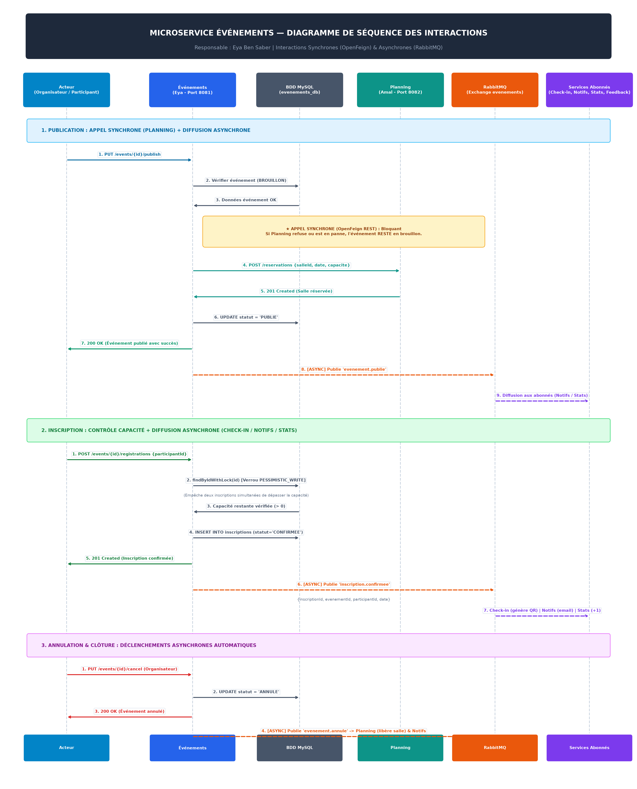
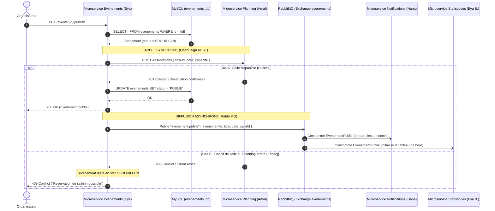
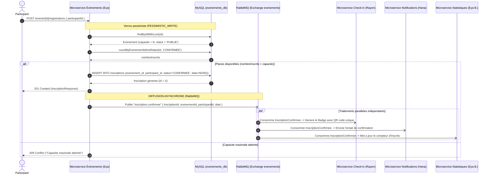
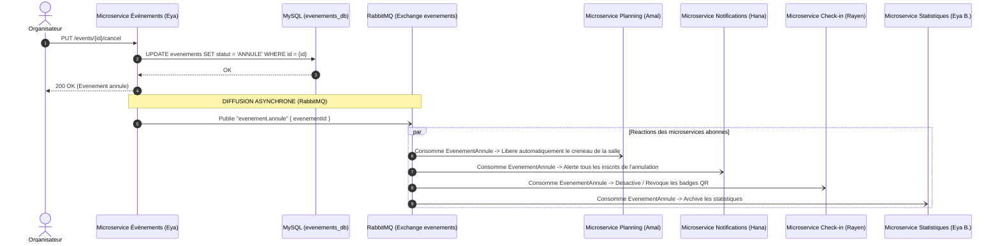
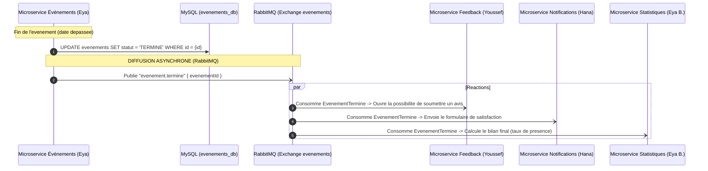

# Diagrammes de Séquence — Microservice Événements (Eya Ben Saber)

Ce document présente les diagrammes de séquence détaillant les interactions synchrones et asynchrones du microservice **Événements**.

---

## 1. Publication d'un événement (Synchrone Planning + Asynchrone RabbitMQ)

Ce flux illustre :
1. **L'appel synchrone (REST / OpenFeign)** vers le microservice **Planning** pour réserver la salle. En cas d'indisponibilité ou de conflit, l'événement reste au statut `BROUILLON`.
2. **L'événement asynchrone (RabbitMQ)** `ÉvénementPublié` diffusé aux autres microservices une fois la publication validée.

---

## 2. Inscription d'un participant (Contrôle capacité + Asynchrone InscriptionConfirmée)

Ce flux illustre :
1. La vérification de l'état `PUBLIE` et de la capacité avec verrouillage transactionnel (`PESSIMISTIC_WRITE`).
2. L'émission asynchrone du message `InscriptionConfirmée` vers RabbitMQ pour déclencher en tâche de fond la création du badge QR, la notification et les statistiques.

---

## 3. Annulation d'un événement (Asynchrone ÉvénementAnnulé)

L'organisateur annule l'événement. Le microservice Événements met à jour le statut et prévient tout le monde de façon asynchrone via RabbitMQ.

---

## 4. Clôture d'un événement (Asynchrone ÉvénementTerminé)

Quand un événement arrive à terme, il passe au statut `TERMINE` et émet le message `ÉvénementTerminé`.

---

## 5. Synthèse des Interactions

| Type | Interaction | Protocole | Rôle & Justification |
|---|---|---|---|
| **Synchrone** | **Événements ➔ Planning** | HTTP / REST (OpenFeign) | **Blocage nécessaire :** Impossible de publier un événement sans certitude que la salle est libre. Si Planning est injoignable, l'événement reste en brouillon. |
| **Asynchrone** | **`evenement.publie`** | RabbitMQ (Topic `evenements`) | Informe Notifications, Feedback, Planning et Statistiques de la publication. |
| **Asynchrone** | **`inscription.confirmee`** | RabbitMQ (Topic `evenements`) | Déclenche en arrière-plan la génération du QR badge (Check-in), l'email (Notifications) et l'incrémentation (Statistiques). |
| **Asynchrone** | **`evenement.annule`** | RabbitMQ (Topic `evenements`) | Permet à Planning de libérer immédiatement la salle et à Notifications d'avertir les participants. |
| **Asynchrone** | **`evenement.termine`** | RabbitMQ (Topic `evenements`) | Active la collecte des notes et avis dans le service Feedback. |

